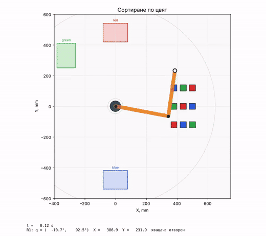

# robosim-kurs: учебен симулатор на робот

Симулатор за курса „Програмиране на роботизирани системи с Python“, магистърска програма „Индустриална роботика“.



Моделира плосък манипулатор с две звена и хващач (тип SCARA), гледан отгоре, върху работна маса с детайли, зони, сензори, препятствия, конвейер и камера. Студентите пишат програми на Python, които управляват робота; не е нужен реален хардуер.

## Инсталиране

Нужен е Python 3.10 или по-нов. В терминала (във VS Code: Ctrl+`):

```
pip install https://github.com/dgoceva/robosim-kurs/archive/refs/heads/main.zip
```

Командата инсталира симулатора и нужните библиотеки (numpy, matplotlib, opencv-python). Не е нужен git. Със същата команда се инсталира и обновена версия.

Ако `pip` не се намира, използвайте `python -m pip install ...` (под Windows и `py -m pip install ...`).

## Примерни програми

```
python -m robosim.examples
```

Командата създава папка `robosim_primeri` с примерните програми и сцените. Отворете папката във VS Code и изпълнете `primer_01_dvizhenia.py` с бутона ▷.

## Първа програма

```python
from robosim import Robot

robot = Robot("sorting.json")
for cube in robot.scene.cubes:
    zone = robot.scene.zone(cube.color)
    robot.move_to(cube.x, cube.y)
    robot.grip()
    robot.move_to(zone.x, zone.y)
    robot.release()
robot.report()
```

Програмите могат да са в произволна папка. Сцените се търсят по име: първо в текущата папка, после в нейната подпапка `scenes` и накрая сред готовите сцени на симулатора (`default`, `sorting`, `palletizing`, `conveyor`, `obstacles`, `drawing`).

## Управление по мрежата

```
python -m robosim.server default.json
```

стартира виртуалния контролер на порт 5000. Програмата се свързва с `from robosim.client import RemoteRobot`.

## Помощни модули

Заедно със симулатора се инсталират модулите от лекциите:

| Модул    | Тема                                          |
| -------- | --------------------------------------------- |
| `frames` | координатни трансформации (тема 6)            |
| `kin2`   | права и обратна кинематика (тема 7)           |
| `traj`   | профили на скоростта и траектории (тема 8)    |
| `vision` | намиране на цветни детайли с OpenCV (тема 10) |

Пълното описание на командите е в ръководството за симулатора към курса.

## Премахване

```
pip uninstall robosim-kurs
```
